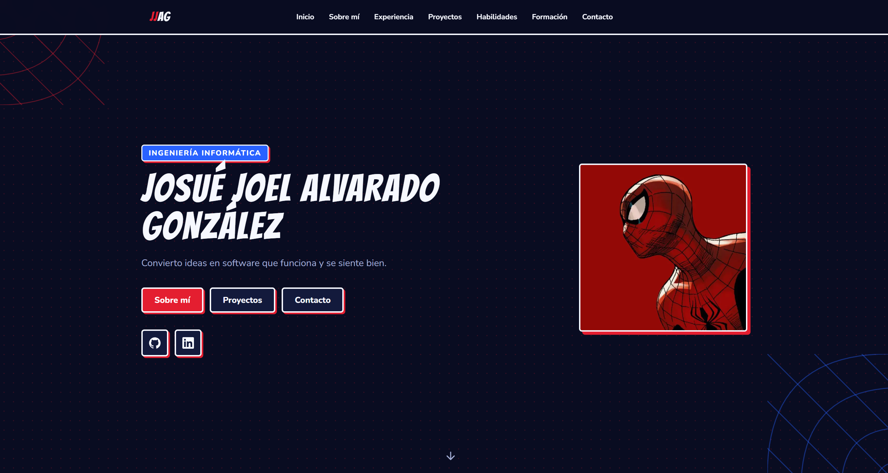

# Portafolio Digital — Josué Joel Alvarado González

Portafolio digital personal de un estudiante de Ingeniería Informática, con temática de Spider-Man y una interfaz inspirada en los videojuegos arcade.

🔗 **Portafolio desplegado:** [PEGA-AQUÍ-TU-ENLACE.vercel.app](https://josue-alvarado.vercel.app/)

## Descripción general

Este proyecto presenta quién soy, mi experiencia, los proyectos que desarrollé durante las 10 semanas de la actividad, mis habilidades y mi formación académica. Incluye un formulario de contacto que envía los mensajes a mi correo mediante un endpoint propio (`POST /api/contact`).

Secciones del portafolio:

1. Inicio (Hero)
2. Sobre mí
3. Experiencia
4. Proyectos
5. Habilidades
6. Formación académica
7. Contacto

## Captura de pantalla



> Guarda una captura de tu portafolio en `public/captura.png` para que se muestre aquí.

## Tecnologías utilizadas

- [Next.js 14](https://nextjs.org/) (App Router): framework principal.
- [React](https://react.dev/): construcción de la interfaz.
- [TypeScript](https://www.typescriptlang.org/): tipado y organización del código.
- [Tailwind CSS](https://tailwindcss.com/): diseño y estilos.
- [Framer Motion](https://www.framer.com/motion/): animaciones al hacer scroll.
- [Lucide Icons](https://lucide.dev/): íconos.
- [Resend](https://resend.com/): envío de correos del formulario de contacto.
- Git y GitHub: control de versiones.
- Vercel: despliegue.

## Instrucciones de instalación

Necesitas [Node.js](https://nodejs.org/) 18.17 o superior y [Git](https://git-scm.com/).

```bash
git clone https://github.com/Dpz-2099/Portafolio-Lowkey-the-best.git
cd Portafolio-Lowkey-the-best
npm install
```

### Variables de entorno

Crea un archivo `.env.local` en la raíz del proyecto (puedes copiar `.env.example`):

```
RESEND_API_KEY=tu_clave_de_resend
CONTACT_TO_EMAIL=tu-correo@ejemplo.com
CONTACT_FROM_EMAIL=onboarding@resend.dev
```

> `.env.local` está en `.gitignore`: nunca se sube a GitHub. Las mismas variables se configuran en Vercel (Settings → Environment Variables).

## Instrucciones para ejecutar el proyecto

```bash
npm run dev      # modo desarrollo en http://localhost:3000
npm run build    # compila la versión de producción
npm run start    # ejecuta la versión compilada
```

## Estructura principal

```
src/
├── app/
│   ├── api/contact/route.ts   # endpoint POST /api/contact
│   ├── globals.css            # colores y estilos del tema
│   ├── layout.tsx             # fuentes y metadatos
│   └── page.tsx               # arma la página con las secciones
├── components/
│   ├── layout/                # Navbar y Footer
│   ├── sections/              # las 7 secciones
│   └── ui/                    # piezas reutilizables
├── data/                      # proyectos, experiencia, habilidades, formación
├── lib/                       # datos personales y validación del formulario
└── types/                     # tipos de TypeScript
```

## Formulario de contacto

El formulario valida nombre, correo y mensaje tanto en el navegador como en el servidor, y muestra en pantalla un mensaje de confirmación o de error. El endpoint `POST /api/contact` responde siempre en formato JSON.

## Lo que aprendí

<!-- ✏️ Reescribe esta sección con tus propias palabras. Ejemplo de ideas: -->

- A usar la terminal de Visual Studio Code
- Crear y pensar los diseños y la interaccion con cada cosa
- A pedir un buen promt a la IA y saberla utilizar como apoyo .
- A proteger credenciales con variables de entorno (`.env.local`) y a no subirlas nunca a GitHub.
- A usar Git y GitHub: commits, ramas, conflictos al unir historiales y `.gitignore`.
- A desplegar en Vercel, configurar variables de entorno y leer los logs para corregir errores de compilación.

## Autor

**Josué Joel Alvarado González** 

- GitHub: [Dpz-2099](https://github.com/Dpz-2099)
- LinkedIn: [no tengo aun ]
